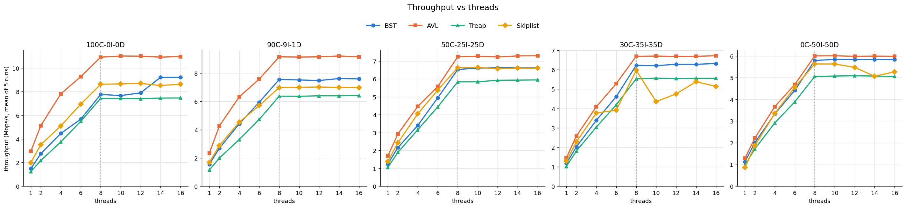
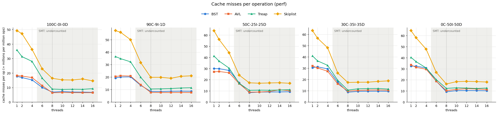

# canopy: concurrent BST, AVL tree, treap and skiplist (HPC Assignment 3)

Four concurrent ordered sets with `contains`, `insert` and `remove`, benchmarked on
five workloads at 1–16 threads. Keys are drawn from [1, 2M], each structure is
prefilled with 1M keys (50%), each run lasts 10 s, and every reported throughput
is the mean of 5 runs. Cache misses per million operations come from `perf stat`.

```
src/common.hpp     spinlock, epoch-based memory reclamation, RNG
src/lo_tree.hpp    BST, AVL and Treap (one logical-ordering core, three balancing policies)
src/skiplist.hpp   lazy skiplist
src/bench.cpp      benchmark harness + concurrent correctness stress test
scripts/run_all.sh     full throughput sweep (any OS)        -> results/throughput.csv
scripts/perf_cache.sh  full sweep under perf stat (Linux)    -> results/perf_cache.csv
scripts/plot.py        plots + tables                        -> results/*.png, results/tables.md
```

## Build and run

```bash
make                       # g++ >= 11 (13+ preferred) or clang >= 17, -std=c++23 -O3
./bench test               # correctness tests: all four structures, 16 threads
./bench test treap         # ... or just one structure
./bench avl 8 50 25        # one config: AVL, 8 threads, 50C-25I-25D, 5 x 10 s
scripts/run_all.sh         # all 180 configs (~2.7 h); resumable
scripts/perf_cache.sh      # Linux: same sweep under perf stat (~2.7 h); resumable
python3 scripts/plot.py
```

For perf on Linux: `sudo apt install linux-tools-$(uname -r)` and
`sudo sysctl kernel.perf_event_paranoid=1`. Bare metal is best: most VMs and WSL2
do not expose the hardware cache counters.

## Design

### BST, AVL and Treap: logical ordering (Drachsler, Vechev, Yahav, PPoPP'14)

All three trees share one core (`LoTree<Balance>`). Each node is in two structures:

* A sorted doubly linked list (`pred`/`succ`, guarded by per-node `succLock`).
  Only the list decides whether a key is in the set. Insert and remove linearize
  when they change `p->succ`.
* The physical tree (`left`/`right`/`parent`, guarded by per-node `treeLock`).
  It is only an index into the list.

`contains` takes no locks and never retries. It walks the tree to some node,
then walks `pred`/`succ` to the exact spot. A rotation or relocation can send the
tree walk to the wrong place, but the list walk always corrects it. This
is what lets the AVL and the treap restructure freely while readers run.

Updates lock the list first (`pred.succLock`, then `node.succLock`), then the tree.
These rules make the code deadlock-free:

1. Take succLocks before treeLocks, and succLocks in key order.
2. Block on a treeLock only while holding no other treeLock. Try-lock any further
   treeLock, and on failure release them all and retry.
3. Change `x.left/right/height` only under `x.treeLock`. Change `x.parent` only
   while holding the treeLocks of both the old and the new parent. So holding
   a node's lock and checking `x.parent == P` proves P really is the parent.

The three trees differ only in physical maintenance:

| | insert | remove |
|---|---|---|
| BST | attach as leaf under `pred` or `succ` (one of them always has a free slot) | 0/1 child: splice. 2 children: move the in-order successor into its place. Tree locks are taken *before* the logical unlink, as in the paper |
| AVL | same, then walk up fixing heights and doing single/double rotations | same as BST, then rebalance from the lowest changed node |
| Treap | same, then rotate up while priority > parent's | mark + unlink from the list, then rotate the node down below its higher-priority child until it has ≤ 1 child, then splice |

The AVL tree uses *relaxed* balance, as concurrent AVL trees usually do: heights
are read without locks and fixed by later rebalances. In every stress run so far
it has had 0 balance violations at quiescence, with depth 22–23 for ~524K keys
(log₂ n ≈ 19). The treap's heap order is also relaxed. In rare interleavings a
node finishes its upward rotations just before an ancestor rotates, which leaves
a priority inversion: at most 1 inversion per run at 64 and 4096 keys, 0 at 1M
keys. Both are design choices. Balance and heap order affect only shape and
speed, never which keys are in the set. So the stress test reports them (the
`violations` and `depth` columns) but does not fail on them.

### Skiplist: lazy skiplist (Herlihy, Lev, Luchangco, Shavit, 2007)

Insert and remove lock only the predecessors of the affected node, then validate.
`contains` is wait-free: a node is present iff it is `fullyLinked` and not `marked`.
Nodes are over-allocated to their real height (geometric with p = ½, max 22 levels),
so a node costs exactly its own levels.

### Memory reclamation

Removed nodes go to epoch-based reclamation. A node retired while the global
epoch is *e* is freed once the epoch reaches *e + 3*, after every thread that could
still hold a pointer to it has left its operation. Textbook EBR waits until
*e + 2*. That is not enough here, because a removed tree node that is still
physically linked keeps `pred` pointers to nodes removed after it, so a reader can
reach a node one epoch later than plain EBR assumes. See "Bugs found after the
benchmarks" below. Without reclamation, a 10-second write-heavy run would leak
several GB.

### Harness

* A fresh structure for every run, prefilled in parallel with 1M distinct random keys.
* Worker threads wait at a barrier. The main thread starts the clock, sleeps 10 s,
  and then raises a stop flag. Throughput = total ops ÷ measured elapsed time.
* Each operation picks a key uniform in [1, 2M] and an op type from the workload mix.
* `perf stat` starts disabled (`-D -1`). The harness enables counting just before
  the workers start and disables it right after they join, over perf's
  `--control` fds, so prefill and teardown are excluded. Misses per million ops =
  cache-misses ÷ (total ops across all runs of that config ÷ 10⁶). The perf sweep
  used 1 run per config, see the perf section.
* The 90C-9I-1D mix is not stationary. Inserts outnumber removes 9 to 1, so
  during a run the set grows from 1M toward about 1.8M keys: it settles where
  successful inserts equal successful removes, 0.09 (1 − f) = 0.01 f, so f = 0.9.
  The other four mixes keep the set at 1M.

## Correctness

`./bench test` runs every structure with 16 threads for 2 s at three key ranges:
64 keys (extreme contention), 4096, and 1M. The mix is 20C-40I-40D. Each thread
records, per key, its successful inserts minus successful removes. Afterwards:

* For every key, the summed balance is 0 or 1, and it equals `contains(key)`.
* For the trees, in-order traversal == the logical list, no node is marked, and
  every `parent` pointer is consistent.
* For the skiplist, every level is sorted, contains only live nodes, and is a
  subset of the levels below.
* Structure size == number of keys with balance 1.

A second, deterministic test targets one specific race. It freezes a thread
inside `remove(512)`, between the logical and the physical unlink. It then
re-inserts 512 from another thread and requires `contains(512)` to see the new
copy.

```
bst       threads=16 range=64       size=37       depth=7    violations=0      PASS
bst       threads=16 range=4096     size=2071     depth=44   violations=0      PASS
bst       threads=16 range=1048576  size=523370   depth=45   violations=0      PASS
bst       zombie re-insert visible to contains                       PASS
avl       threads=16 range=64       size=30       depth=6    violations=0      PASS
avl       threads=16 range=4096     size=2048     depth=13   violations=0      PASS
avl       threads=16 range=1048576  size=524108   depth=22   violations=0      PASS
avl       zombie re-insert visible to contains                       PASS
treap     threads=16 range=64       size=27       depth=7    violations=1      PASS
treap     threads=16 range=4096     size=2039     depth=21   violations=1      PASS
treap     threads=16 range=1048576  size=524266   depth=45   violations=0      PASS
treap     zombie re-insert visible to contains                       PASS
skiplist  threads=16 range=64       size=30       depth=8    violations=0      PASS
skiplist  threads=16 range=4096     size=1999     depth=11   violations=0      PASS
skiplist  threads=16 range=1048576  size=524776   depth=20   violations=0      PASS
ALL PASS
```

### Bugs found after the benchmarks

An external review and repeated stress runs found two races in the tree code.
Both are fixed and covered by tests.

1. `contains` could miss a re-inserted key. `search` stops at the first tree
   node holding the key. That node can be a "zombie": already removed from the
   list but not yet from the tree, while a new copy of the same key has been
   inserted below it. The old `contains` then answered from the zombie and
   returned false for a key that was present. The fix answers from the list:
   it reads `succ` only from a node that is still unmarked afterwards, which
   makes that read the true successor at that moment. The zombie test above
   fails on the old code for BST and AVL (the treap's random shape avoided it)
   and passes now.
2. Memory reclamation freed nodes one epoch too early (see Memory
   reclamation). A reader standing on a zombie could follow its stale `pred`
   pointer into freed memory, and even lock a node whose memory had been
   reused, which breaks mutual exclusion on the list. Under extreme contention
   (16 threads, 4096 keys) the treap failed the stress test in 3 of 18 runs:
   the list held keys that the insert/remove history said were gone. The treap
   hits this most because its zombies live longest while they rotate down.
   With the extra epoch it failed in 0 of 20 runs; at the old rate about 3
   failures were expected, and 0 by luck has about a 3% chance.

The throughput and perf data below were measured with the code before these
fixes. Both races need a removal and a concurrent operation on the same key, or
on an already removed node, within a short window. The fixes add a mark check
on a node that is already in cache, plus a slightly longer delay before freeing.
3-second spot checks of the old and new builds agree within run-to-run noise:

| config | old build | fixed build |
|---|---:|---:|
| AVL 8 threads 50C-25I-25D | 7.91 | 7.63 |
| treap 8 threads 50C-25I-25D | 5.37 | 5.45 |
| BST 8 threads 100C-0I-0D | 8.30 | 8.30 |
| AVL 1 thread 100C-0I-0D | 2.72 | 2.73 |

## Results

Test machine: Intel Core i7-1165G7 (4 cores / 8 hardware threads, 2.8 GHz,
12 MB L3), 8 GB RAM, Windows 10, GCC 14.2 `-O3 -march=native`. The laptop was
on AC power with the High performance plan, and nothing else heavy was running.
The dotted line in the plots marks 8 threads. Beyond it the machine is
oversubscribed, so gains above 8 threads come only from hiding lock/memory stalls,
not from more cores. Two configs whose runs were disturbed (the machine entered
standby mid-run, or ran short of memory) were re-run, and the data is in
`results/throughput.csv`. An earlier sweep taken on battery power is kept in
`results/throughput_noisy_battery.csv` for reference only. Battery throttling
made it 2–3× slower and erratic, so it is not used.



### Analysis

Scaling. Every structure keeps scaling up to 8 threads (4 cores plus hyper-threads): 3.7–6.5× the
1-thread throughput at 8 threads (e.g., AVL 100C: 2.96 → 10.91 Mops/s; BST
0C-50I-50D: 1.12 → 5.79). Beyond 8 threads throughput is flat. The CPU has no more
hardware threads, and none of the structures collapse under oversubscription,
because the spinlocks yield after a short spin. So 8 threads is the real
saturation point on this machine. The 10–16 thread points show robustness, not
extra scalability.

AVL is the fastest in every workload. On a read-heavy mix it beats the BST by
about 2× at 1 thread and 1.2–1.4× at 8 threads. An AVL lookup visits fewer
nodes: the tree stays close to log₂ n deep (bound 1.44 log₂ n; 22 for 521K keys in
the stress test), while a random BST averages about 2 ln n ≈ 28 levels and reaches
47. The perf section below shows where the saving lands. It is not in L3
misses, since BST and AVL miss L3 about equally often. It is in fewer L2 misses
and a shorter chain of dependent loads. The AVL pays for rotations only on
updates, and the logical-ordering design keeps readers lock-free during them, so
balance is nearly free for readers.

The gap narrows as writes grow. At 0C-50I-50D, AVL (6.0) is only about 4%
ahead of the BST (5.8). Every successful update in the AVL walks up to rebalance,
takes extra tree locks, and its rotations invalidate cache lines that other
threads are traversing. With uniform random keys the unbalanced BST is already
"randomly balanced", so its extra depth costs less than AVL maintenance saves.

The treap is the slowest tree. With uniform keys a treap has the same expected
shape as the random BST, but it pays for priorities: rotate-up on every insert and
rotate-down on every remove. It reaches 0.74–0.97× the BST's throughput, and perf
shows it also misses L3 about twice as often (see the perf section). Its benefit
(balance independent of insertion order) does not show with uniform random keys.
It would show with sorted or skewed inserts, where the plain BST degenerates.

The skiplist is competitive on read-heavy mixes on Windows (second at 1–8
threads in 100C), thanks to wait-free `contains` and towers that make search
paths short. That ranking depends on the platform: in the Linux runs
(`results/throughput_linux.csv`, GCC 11) it falls behind the BST (1.26 vs 1.49
Mops/s at 1 thread). It is also the least steady on the write-heavy 30C-35I-35D
mix. It dips at 6 threads (3.91, below the 4-to-8-thread trend of 3.77 → 5.96)
and again past 8 threads (4.36–5.38), and these configs have the highest
run-to-run variation of any skiplist config (10% at 6 threads, 14% at 12). An
insert locks up to `top+1` predecessors and a remove holds the victim's lock
while it retries. Past 8 threads, preemption of a lock holder stalls everyone
queued behind it. That cannot explain the 6-thread dip, though, since the
machine is not oversubscribed there. The cause of that dip was not isolated.

Read-only vs update mixes. Throughput falls as the update ratio rises for
every structure (AVL at 8 threads: 10.9 → 9.2 → 7.2 → 6.7 → 6.0 Mops/s). Updates
take locks, allocate and reclaim nodes, and write shared cache lines that other
cores then miss on.

Noise. Most configs have a coefficient of variation below 5% across the 5
runs. Six exceed 10%: BST 100C at 1, 2 and 4 threads (21%, 13%, 10%), skiplist
0C-50I-50D at 1 thread (19%), and skiplist 30C-35I-35D at 6 and 12 threads (10%,
14%). The two 1-thread outliers are a trend, not scatter. Throughput rises
almost every run (BST 100C: 1.05 → 1.27 → 1.68 → 1.73 → 1.73; skiplist 0C:
0.65 → 1.08), which looks like warm-up (CPU frequency or allocator state). It
lowers those 1-thread means and so inflates their speedups: BST 100C scales 5.2×
from 1 to 8 threads using the mean, but 4.5× against its last, warm runs. There
is also a BST 100C step up at 14–16 threads. All of this is consistent with a
laptop's turbo and background activity. An untimed warm-up phase per run and
pinned threads on a dedicated machine would tighten it.

### Cache misses per million operations (perf)

Test machine: the same laptop (Intel Core i7-1165G7, 4 cores / 8 hardware
threads, 12 MB L3) booted into Ubuntu 22.04 on bare metal, kernel
5.15.0-1109-intel-iotg, perf 5.15, GCC 11.4 `-O3 -march=native`, on AC power
with the performance power profile. `cache-misses` and `cache-references` are
the generic perf events, which on this CPU count last-level (L3) misses and
references. Counting covers only the timed phase of each run: the harness
enables and disables the counters through perf's `--control` fds, so prefill
and teardown are excluded. Each config was run once for 10 s (1 run, not 5),
so these numbers carry more noise than the throughput table. The same sweep
also wrote Linux throughput to `results/throughput_linux.csv`, kept for
reference only. The Windows numbers above remain the reported throughput.

Throughput and cache misses come from different setups: Windows with GCC 14,
and Linux with GCC 11. Linux throughput is within about 20% for the BST and AVL, but 25–45%
lower for the treap and skiplist (treap 100C at 1 thread: 0.90 vs 1.23 Mops/s).
So the analysis below links misses to throughput only through rankings that hold
on both platforms. The AVL is fastest and the treap the slowest tree on both. The
skiplist's place relative to the BST is the one ranking that differs.



Read the 1 to 4 thread points. At 6 threads and above, some threads share a
physical core, and perf then undercounts by about 2 times (measured directly,
see measurement trap 5). That is why every curve drops between 4 and 8 threads and
then goes flat: the drop is an artifact of the counter, not fewer misses.
Comparisons between structures at the same thread count are still fair, since
the artifact hits all four the same way, but the absolute values above 4
threads should not be used.

Misses per operation, 100C-0I-0D at 1 thread: BST 17.7, AVL 18.2, treap 35.8,
skiplist 49.2. At 0C-50I-50D: BST 32.4, AVL 33.5, treap 40.3, skiplist 64.5.

Tree depth does not explain the BST vs AVL gap. The expectation was that the
AVL, at about half the BST's depth, would miss least. It does not: BST and AVL
are within 11% of each other in every workload at 1 to 4 threads, and the BST is
often slightly lower. Yet the AVL is about 2 times faster on read-only work at 1
thread. So the AVL's lead does not come from fewer L3 misses. The data points
to the cheaper levels instead. The AVL makes fewer L3 references per operation
(39 vs 44 on 100C at 1 thread), meaning fewer L2 misses, and a shorter chain of
dependent loads, so the misses that do happen overlap more. The deep part of the
BST is mostly made of nodes near the top that stay cached, and both trees miss
on roughly the same number of cold nodes near the bottom.

The treap misses about twice as often as the BST on read-heavy mixes (35.8 vs
17.7 per op) even though, with uniform keys, it has the same expected shape and
all three trees share one node type, so node size is not the cause. This matches
its position as the slowest tree in the throughput results. Its extra misses
shrink as the update share grows (40.3 vs 32.4 at 0C-50I-50D), because then all
the trees pay for allocation. The cause was not measured. One explanation fits
both this and the BST/AVL tie, but it is an untested hypothesis: allocation
order. A BST is never rotated, so every node's ancestors were inserted before it.
The upper levels are therefore the earliest allocations, which sit close together
in memory where the TLB and hardware prefetchers serve them well. The AVL keeps
most of that layout, because its rotations happen mostly near the leaves. A
treap's shape is set by random priorities: the root is whichever node drew the
highest priority, whenever it was inserted. So every level of a treap is spread
across the whole node heap. To test it, prefill the BST in a shuffled allocation
order (allocate all nodes, shuffle them, then link them) and see whether its
misses rise to the treap's level.

The skiplist touches the most memory, as expected: 2.5 to 3 times the BST's
misses per op at 1 thread, and about 2 times the references. A search visits
about two nodes per level over roughly 20 levels, and each tower is a separate
allocation. It still keeps up in read-heavy throughput, because its wait-free
`contains` takes no locks and the misses at different levels are partly
independent.

Updates add misses. At 1 thread, where there is no sharing at all, going from
100C to 0C-50I-50D almost doubles the misses per op for BST (17.7 to 32.4) and
AVL (18.2 to 33.5). That cost comes from allocating fresh nodes, freeing old ones
through epoch reclamation, and writing lock words, not from coherence.
Coherence misses do not show up here: from 1 to 4 threads the update-heavy
misses per op stay flat or fall slightly (AVL 0C-50I-50D: 33.5, 31.3, 29.6). On
this single-socket CPU a line moving between cores is served by the shared L3,
so it never counts as an L3 miss. Measuring coherence traffic would need
core-to-core events (for example HITM snoops), which these generic events do
not include.

#### Cache misses per million operations, full table

1 run of 10 s per config. Values at 6 threads and above are undercounted
(measurement trap 5).

##### 100C-0I-0D

| threads | BST | AVL | Treap | Skiplist |
|---:|---:|---:|---:|---:|
| 1 | 17,738,502 | 18,244,111 | 35,831,558 | 49,217,763 |
| 2 | 16,872,825 | 17,905,882 | 31,322,256 | 47,105,800 |
| 4 | 15,228,009 | 16,860,270 | 28,005,983 | 36,275,525 |
| 6 | 10,080,357 | 11,308,414 | 16,503,482 | 22,910,317 |
| 8 | 6,814,832 | 6,409,526 | 8,963,307 | 16,342,621 |
| 10 | 7,261,146 | 6,595,487 | 8,704,332 | 15,297,909 |
| 12 | 6,902,052 | 6,496,604 | 8,839,636 | 15,211,457 |
| 14 | 6,854,601 | 6,435,688 | 8,785,335 | 15,907,771 |
| 16 | 6,698,460 | 6,456,285 | 9,217,050 | 14,601,077 |

##### 90C-9I-1D

| threads | BST | AVL | Treap | Skiplist |
|---:|---:|---:|---:|---:|
| 1 | 19,251,320 | 20,434,836 | 36,502,639 | 57,248,600 |
| 2 | 20,077,230 | 21,063,053 | 34,818,810 | 55,959,241 |
| 4 | 20,156,236 | 20,863,878 | 32,226,789 | 49,960,910 |
| 6 | 13,417,969 | 13,851,965 | 19,904,737 | 31,651,933 |
| 8 | 8,500,938 | 7,700,895 | 10,473,977 | 19,822,539 |
| 10 | 8,422,560 | 7,643,952 | 10,594,420 | 19,835,697 |
| 12 | 8,623,885 | 7,616,773 | 10,842,281 | 19,054,356 |
| 14 | 8,730,492 | 7,669,554 | 11,282,642 | 20,648,342 |
| 16 | 8,674,411 | 7,640,570 | 11,473,010 | 21,036,909 |

##### 50C-25I-25D

| threads | BST | AVL | Treap | Skiplist |
|---:|---:|---:|---:|---:|
| 1 | 30,014,997 | 27,087,234 | 41,279,142 | 63,997,686 |
| 2 | 29,873,247 | 27,390,300 | 36,766,168 | 56,132,376 |
| 4 | 28,336,109 | 26,212,072 | 30,406,374 | 44,243,884 |
| 6 | 17,298,782 | 16,457,877 | 16,788,548 | 24,084,222 |
| 8 | 8,420,511 | 8,860,301 | 10,529,230 | 17,237,960 |
| 10 | 8,952,223 | 8,991,869 | 10,684,650 | 16,875,572 |
| 12 | 9,020,102 | 9,464,889 | 10,602,696 | 17,120,098 |
| 14 | 9,087,735 | 10,946,241 | 10,779,590 | 17,297,585 |
| 16 | 9,244,137 | 10,238,294 | 11,096,318 | 16,807,192 |

##### 30C-35I-35D

| threads | BST | AVL | Treap | Skiplist |
|---:|---:|---:|---:|---:|
| 1 | 30,476,275 | 31,989,785 | 40,889,051 | 63,300,349 |
| 2 | 31,200,596 | 30,226,391 | 36,502,351 | 56,605,275 |
| 4 | 29,387,132 | 27,265,246 | 32,535,464 | 48,102,191 |
| 6 | 17,743,318 | 16,183,750 | 19,294,289 | 25,694,155 |
| 8 | 8,724,254 | 9,681,709 | 10,586,632 | 17,359,963 |
| 10 | 9,463,943 | 10,309,902 | 11,737,443 | 17,566,294 |
| 12 | 9,547,331 | 10,612,058 | 11,939,535 | 17,623,004 |
| 14 | 9,624,898 | 10,724,420 | 12,024,544 | 18,284,652 |
| 16 | 9,530,470 | 10,505,453 | 11,480,940 | 18,776,454 |

##### 0C-50I-50D

| threads | BST | AVL | Treap | Skiplist |
|---:|---:|---:|---:|---:|
| 1 | 32,375,925 | 33,458,415 | 40,327,369 | 64,485,830 |
| 2 | 32,420,946 | 31,327,404 | 36,493,453 | 58,038,374 |
| 4 | 30,773,367 | 29,629,638 | 30,784,988 | 47,716,007 |
| 6 | 18,874,265 | 18,846,804 | 20,266,448 | 26,808,025 |
| 8 | 9,275,577 | 10,309,458 | 12,342,674 | 16,299,900 |
| 10 | 10,291,043 | 11,417,651 | 12,846,198 | 18,412,997 |
| 12 | 10,370,207 | 12,094,738 | 12,625,382 | 18,676,906 |
| 14 | 10,308,199 | 11,804,254 | 12,237,146 | 18,430,753 |
| 16 | 10,176,674 | 11,364,581 | 12,645,457 | 18,095,775 |

### Full throughput table

Mops/s, mean of 5 × 10 s runs.

#### 100C-0I-0D

| threads | BST | AVL | Treap | Skiplist |
|---:|---:|---:|---:|---:|
| 1 | 1.49 | 2.96 | 1.23 | 2.00 |
| 2 | 2.75 | 5.13 | 2.18 | 3.51 |
| 4 | 4.46 | 7.81 | 3.75 | 5.10 |
| 6 | 5.67 | 9.27 | 5.49 | 6.94 |
| 8 | 7.76 | 10.91 | 7.43 | 8.62 |
| 10 | 7.66 | 11.01 | 7.42 | 8.66 |
| 12 | 7.90 | 11.00 | 7.40 | 8.70 |
| 14 | 9.21 | 10.92 | 7.45 | 8.51 |
| 16 | 9.21 | 10.97 | 7.46 | 8.63 |

#### 90C-9I-1D

| threads | BST | AVL | Treap | Skiplist |
|---:|---:|---:|---:|---:|
| 1 | 1.56 | 2.34 | 1.15 | 1.68 |
| 2 | 2.69 | 4.26 | 1.99 | 2.87 |
| 4 | 4.42 | 6.33 | 3.31 | 4.54 |
| 6 | 5.95 | 7.59 | 4.73 | 5.71 |
| 8 | 7.56 | 9.16 | 6.37 | 6.99 |
| 10 | 7.52 | 9.14 | 6.37 | 7.00 |
| 12 | 7.48 | 9.16 | 6.40 | 7.02 |
| 14 | 7.62 | 9.22 | 6.40 | 6.99 |
| 16 | 7.60 | 9.15 | 6.42 | 6.98 |

#### 50C-25I-25D

| threads | BST | AVL | Treap | Skiplist |
|---:|---:|---:|---:|---:|
| 1 | 1.25 | 1.70 | 1.05 | 1.38 |
| 2 | 2.16 | 2.92 | 1.89 | 2.43 |
| 4 | 3.40 | 4.47 | 3.16 | 4.05 |
| 6 | 4.95 | 5.58 | 4.44 | 5.38 |
| 8 | 6.53 | 7.24 | 5.84 | 6.63 |
| 10 | 6.61 | 7.28 | 5.84 | 6.65 |
| 12 | 6.63 | 7.23 | 5.93 | 6.57 |
| 14 | 6.62 | 7.29 | 5.93 | 6.61 |
| 16 | 6.62 | 7.30 | 5.95 | 6.60 |

#### 30C-35I-35D

| threads | BST | AVL | Treap | Skiplist |
|---:|---:|---:|---:|---:|
| 1 | 1.17 | 1.45 | 1.02 | 1.28 |
| 2 | 2.03 | 2.59 | 1.81 | 2.28 |
| 4 | 3.39 | 4.09 | 3.04 | 3.77 |
| 6 | 4.62 | 5.28 | 4.19 | 3.91 |
| 8 | 6.22 | 6.69 | 5.53 | 5.96 |
| 10 | 6.21 | 6.70 | 5.56 | 4.36 |
| 12 | 6.28 | 6.68 | 5.54 | 4.75 |
| 14 | 6.28 | 6.69 | 5.55 | 5.38 |
| 16 | 6.32 | 6.72 | 5.56 | 5.14 |

#### 0C-50I-50D

| threads | BST | AVL | Treap | Skiplist |
|---:|---:|---:|---:|---:|
| 1 | 1.12 | 1.28 | 0.97 | 0.86 |
| 2 | 2.01 | 2.22 | 1.72 | 1.86 |
| 4 | 3.33 | 3.67 | 2.92 | 3.35 |
| 6 | 4.42 | 4.68 | 3.89 | 4.55 |
| 8 | 5.79 | 6.00 | 5.06 | 5.63 |
| 10 | 5.84 | 6.01 | 5.08 | 5.63 |
| 12 | 5.84 | 5.99 | 5.09 | 5.48 |
| 14 | 5.84 | 5.99 | 5.07 | 5.06 |
| 16 | 5.84 | 5.99 | 5.06 | 5.27 |

## Measurement traps

Five things corrupted early numbers. All were caught by reading the data, not by the harness.

1. Battery power. The first full sweep ran unplugged on the Balanced plan.
   Windows throttled the CPU, so the numbers came out 2 to 3 times too low and
   erratic: read-only BST at 1 thread measured slower than write-only BST. The
   data is kept in `results/throughput_noisy_battery.csv`. The final sweep ran
   on AC with the High performance plan.
2. A system install mid-sweep. A WSL install ran during the battery sweep, and
   AVL read-only at 8 threads measured 5.0 instead of 8.8 Mops/s. That created a
   fake "jump" at 12 threads, the kind of curve that is easy to explain and
   wrong. Re-measuring single points is what exposed it.
3. Modern Standby. Disabling sleep is not enough on this laptop: turning the
   display off puts it into Modern Standby, which froze the sweep for 10 hours
   in the middle of a run. One 10 s run then reported 0.001 Mops/s. Its config
   was re-run, and the display timeout is now disabled during sweeps.
4. Memory pressure. On 8 GB, other programs pushed the machine into swapping, and
   one run fell to a third of its siblings' throughput. Any run below 50% of its
   config's mean is now treated as disturbed and its config is re-run. The final
   CSV has none.
5. Hyper-threading undercounts perf events. In the cache-miss sweep, misses per
   op fell by 2 to 3 times between 4 and 8 threads for every structure, right
   where threads start sharing physical cores. A direct test exposed it, using
   independent single-threaded AVL runs (1M-key prefill, then 4 s of reads)
   pinned with `taskset`. The prefill alone, identical work in every case,
   recorded 30M misses on its own but 18M per run when two runs shared one
   core's two hyperthreads. In the timed phase, two runs on separate cores
   showed 25.7 misses per op, and two runs on sibling hyperthreads 12.5.
   Siblings share L1 and L2, so if anything they should miss more often, not
   half as often. The counter is therefore missing about half the events
   whenever both hyperthreads of a core are busy. This experiment was run by
   hand during the Linux session, and its commands are not in the repo. The 1 to 4 thread
   counts are therefore trusted, and the 6 to 16 thread counts are only
   compared with each other. A clean high-thread measurement would need SMT
   disabled, which caps the machine at 4 threads.
