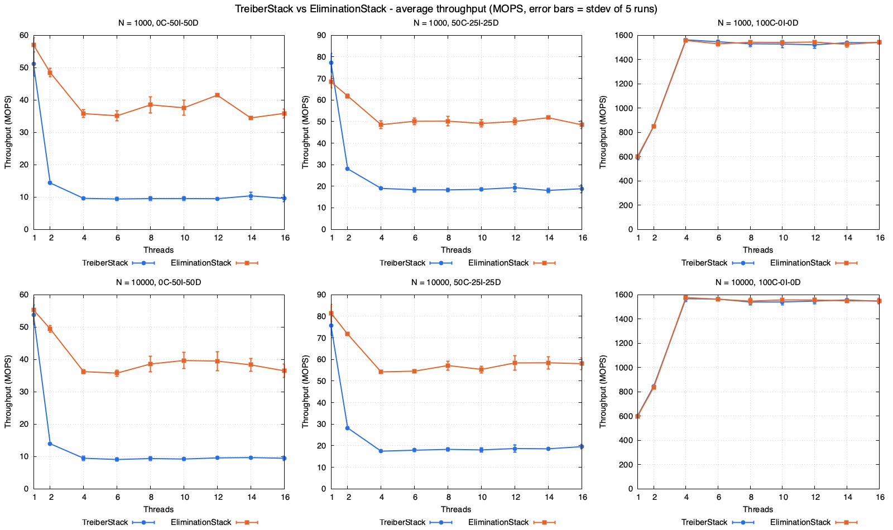

# lockstep: lazy vs lock-free concurrent data structures (HPC Assignment 2)

Seven concurrent data structures in Java, each in a lock-based (lazy, validating)
and a non-blocking (CAS) flavour, benchmarked across 1 to 16 threads, two problem
sizes and three read/write mixes. 1,890 timed runs, all raw data included.

```
src/       the seven structures, Bench.java (timing harness), Check.java (correctness test)
scripts/   run_all.sh (sweep), analyze.py (averages, speedup), plots.gp, make_report.py
results/   raw/ one CSV per configuration, all_runs.csv, averages.csv, data/ for gnuplot
plots/     throughput and speedup grids for each comparison
report/    report.pdf, plus the HTML sources it is built from
```

| structure | lock-based | non-blocking |
|---|---|---|
| doubly linked list | `LazyDList`: optimistic traversal, lock pred+curr, validate, mark then unlink | `LockFreeDList`: Harris-Michael, `AtomicMarkableReference`, helping |
| stack | `LockStack`: read top, lock, validate top unchanged, publish | `TreiberStack`: CAS on `top` |
| queue | `LockQueue`: two locks, head and tail never contend | `MSQueue`: Michael-Scott, threads help a lagging tail |
| elimination | | `EliminationStack`: Treiber plus an 8-slot lock-free exchanger array |

Every class lists its linearization points in its header comment; the report has
them as a table.

---

## Run

```sh
java -cp build Check                 # after javac -d build src/*.java; all seven must print OK
scripts/run_all.sh 2000 5            # full grid, 2 s per run, 5 runs (~65 min on 4 cores)
scripts/run_all.sh 10000 5           # the assignment's 10 s runs (~5.5 h)
python3 scripts/make_report.py       # report/report.pdf
```

`run_all.sh` skips any configuration whose CSV already exists, so an interrupted
sweep resumes where it stopped. Delete a file to re-measure it.

Prefill (N/2 distinct keys), workload generation and thread creation all happen
before the clock starts. Threads wait on a latch, the main thread takes
`System.nanoTime()`, publishes the deadline and releases them. Throughput is
operations divided by the measured elapsed time, never the nominal one.

---

## Results



- Lists scale until the cores run out: 3.5 to 3.9x at 4 threads for N = 10,000,
  flat after that on this 4-core i5-7500. Traversal is read-only, so threads mostly
  share cache lines rather than fight over them.
- The lock-free list scales better at N = 1,000 (3.1x vs 1.6x update-only) but the
  lazy list is faster in absolute terms: each lock-free hop goes through an
  `AtomicMarkableReference` and its immutable pair object, about three dependent
  loads instead of one.
- Stacks and queues get slower with more threads under updates. One hot cache
  line (`top`, `head`) serialises everything, and CAS failures make it worse: the
  Treiber stack drops from 51 MOPS at 1 thread to 9.6 at 4.
- Locks beat CAS under heavy contention. `LockStack` holds 19.5 MOPS where Treiber
  holds 9.6, and the two-lock queue roughly doubles Michael-Scott, because its two
  ends never touch the same lock.
- Elimination is the standout: 3.3 to 4.4x the Treiber stack's throughput at 8 to
  16 threads. Colliding pushes and pops cancel in a side slot and never touch `top`.

---

## Three traps that would have corrupted the numbers

1. `System.nanoTime()` is a global bottleneck on macOS. HotSpot keeps time
monotonic there with a CAS on one shared word, so every call from every thread
hits the same cache line. Measured: about 30 M calls/s on 1 thread, falling to
26 M on 4. Checking the deadline after every operation capped every fast structure
at about 29 MOPS regardless of thread count, so the benchmark was measuring the
clock. The timed loop now checks the deadline once per 64 operations; peek went
from a flat 29 MOPS to 1,400+.

2. Linked queues leak through the garbage collector. A dequeued sentinel promoted
to the old generation still points at younger nodes and keeps them alive, so each
young collection copies the queue's entire history. GC logs showed 125 to 160 ms
pauses and a live heap climbing from 95 MB to 290 MB, with runs overshooting
their deadline by up to 0.8 s. Both queues now self-link a dequeued node
(`h.next = h`), the same fix `java.util.concurrent.ConcurrentLinkedQueue` uses.

3. A sleeping laptop pauses the clock. `System.nanoTime()` stops while macOS
sleeps, so a run that straddles sleep looks short and slow rather than broken.
`caffeinate -i` does not stop idle sleep; `run_all.sh` should be run under
`caffeinate -dims` on AC power, and every raw file was checked for elapsed times
above 2.05 s before the results were accepted.

All three produced plausible numbers rather than errors, which is why they are
written down here.

---

## Deviations from the assignment

- Runs last 2 s instead of 10 s, to fit the grid into one evening on one machine.
  The duration is a parameter; `scripts/run_all.sh 10000 5` is the spec-exact run.
- Prev pointers in the lock-free list are hints, kept up to date after every link
  and unlink but never relied on for correctness. A fully symmetric lock-free
  doubly linked list needs multi-word CAS, which Java does not have.
